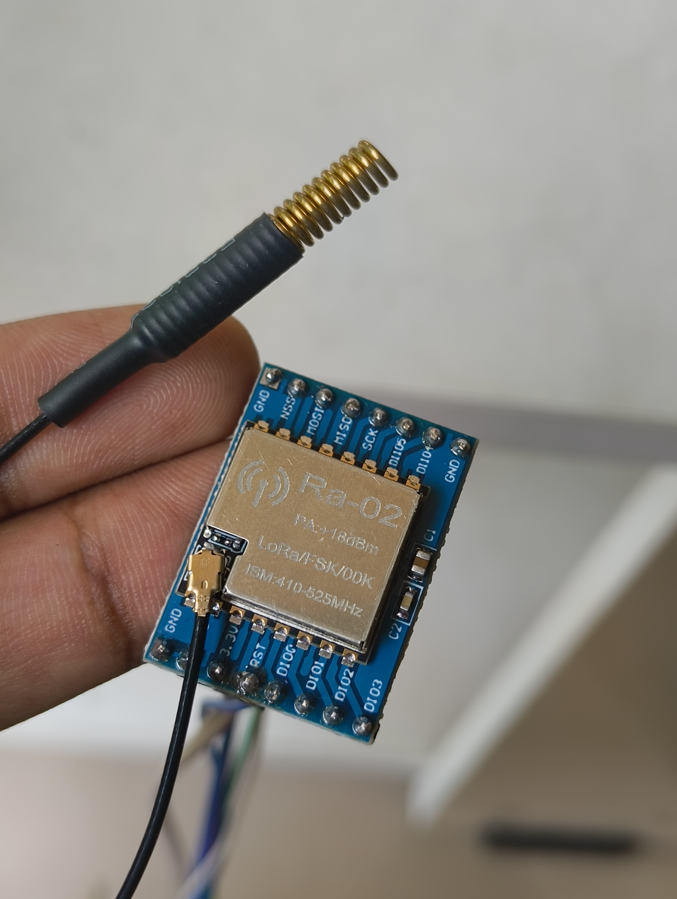
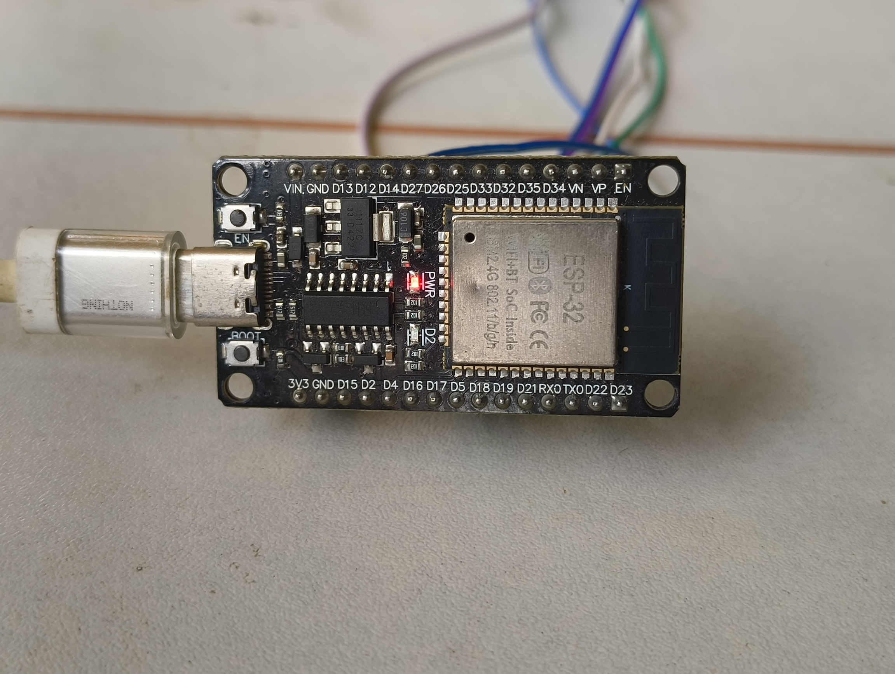
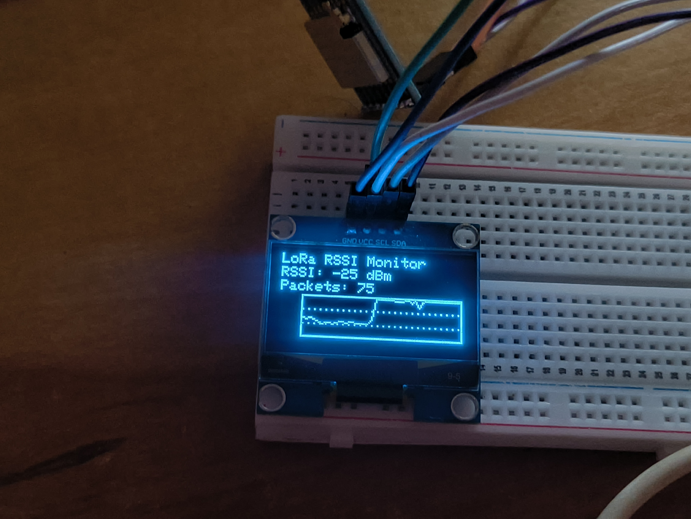

# LoRa-Based Distributed Landslide Early Warning System

A distributed landslide monitoring and early warning system designed to collect environmental and ground-movement data from multiple sensor nodes and transmit it wirelessly using LoRa. The project aims to identify potential slope instability and generate early warnings through real-time sensor monitoring and data analysis.

The system uses ESP32 microcontrollers and RA-02 SX1278 LoRa modules to establish long-range wireless communication between remote monitoring nodes and a central receiver. A miniature soil-slope model will be developed to simulate landslide conditions and evaluate the proposed system.

> **Project Status:** Phase 1 — LoRa communication testing completed. Sensor integration, simulated landslide experiments, and early warning implementation are in progress as future development stages.

## Objectives

- Develop a distributed system for monitoring potential landslide conditions.
- Establish reliable wireless communication between sensor nodes and a central gateway using LoRa.
- Integrate sensors to monitor ground vibration, tilt, soil moisture, and other relevant parameters.
- Develop a miniature sand/soil model to simulate slope instability and landslide events.
- Analyze sensor measurements to identify changes associated with increasing slope instability.
- Implement a warning mechanism using visual and audible alerts.
- Evaluate communication reliability and system performance under simulated conditions.

## System Architecture

The proposed system consists of distributed sensor nodes, a LoRa communication link, and a central monitoring unit.

```text
       DISTRIBUTED SENSOR NODES
  ┌──────────────────────────────┐
  │ Node 1: ESP32 + Sensors      │
  │ Node 2: ESP32 + Sensors      │
  │ Node 3: ESP32 + Sensors      │
  └──────────────┬───────────────┘
                 │
          LoRa Wireless Link
                 │
                 ▼
  ┌──────────────────────────────┐
  │ Central LoRa Gateway         │
  │ ESP32 + RA-02 SX1278         │
  └──────────────┬───────────────┘
                 │
                 ▼
  ┌──────────────────────────────┐
  │ Data Processing and Analysis │
  │ Monitoring Dashboard         │
  └──────────────┬───────────────┘
                 │
                 ▼
  ┌──────────────────────────────┐
  │ Warning Indicators           │
  │ LED / Buzzer / Display       │
  └──────────────────────────────┘
```

The architecture is planned for multiple distributed sensor nodes. The number of nodes and final processing arrangement may be refined during implementation.

## Hardware Requirements

### Currently used hardware

| Component | Purpose |
|---|---|
| ESP32 DevKit V1 | Microcontroller for LoRa transmitter and receiver |
| RA-02 SX1278 LoRa modules | Wireless communication between transmitter and receiver |
| USB cables | Powering boards and uploading firmware |
| Jumper wires | Hardware connections and testing |

## Hardware Requirements

| Component | Purpose |
|---|---|
| ESP32 DevKit V1 | Microcontroller for sensor nodes and central receiver |
| RA-02 SX1278 LoRa modules | Long-range wireless communication between nodes |
| Compatible LoRa antennas | Wireless signal transmission and reception |
| MPU6050 accelerometer/gyroscope | Monitor tilt, acceleration, and vibration-related motion |
| Capacitive soil moisture sensors | Measure soil moisture conditions |
| VL53L0X time-of-flight distance sensors | Measure surface displacement in the simulated landslide model |
| Rainfall measurement sensor | Monitor rainfall conditions |
| 1.3-inch, 128×64 I2C OLED (SH1106) | Display received measurements, RSSI, and system status |
| LEDs | Provide visual warning indications |
| Buzzer | Provide audible alerts |
| Breadboards | Prototype and connect electronic components |
| Jumper wires | Connect sensors, microcontrollers, and modules |
| USB cables | Power ESP32 boards and upload firmware |
| Sand/soil model | Simulate slope movement and landslide conditions |

> **Note:** The LoRa communication prototype is completed. Sensor integration, the simulated landslide model, and warning logic remain planned development phases. The number of sensors and ESP32 nodes will be finalized during implementation.

## Phase 1: LoRa Communication Testing

**Status: Completed**

The first phase focused on establishing and verifying wireless communication between two ESP32 DevKit V1 boards using RA-02 SX1278 LoRa modules.

### Implemented features

- Configured the LoRa transmitter and receiver.
- Established SPI communication between the ESP32 and SX1278 modules.
- Verified the SX1278 version register response (`0x12`).
- Transmitted test messages between the two boards.
- Received and displayed messages through the Serial Monitor.
- Retrieved RSSI measurements from received packets.
- Developed an OLED-based RSSI graph to visualize received signal strength.

### Communication configuration

| Parameter | Value |
|---|---|
| Microcontroller | ESP32 DevKit V1 |
| LoRa transceiver | RA-02 SX1278 |
| Operating frequency | 433 MHz |
| Spreading factor | 7 |
| Signal bandwidth | 125 kHz |
| Coding rate | 4/5 |
| Sync word | `0x12` |
| CRC | Enabled |
| Serial Monitor | 115200 baud |

These values describe the current test firmware. The final deployment configuration will depend on hardware specifications and applicable radio regulations.

### RSSI monitoring

The receiver uses a 1.3-inch, 128×64 SH1106 OLED display to visualize the received signal strength.

The scrolling graph stores the latest 48 packet RSSI measurements and displays the current RSSI in dBm. This provides a way to observe signal variations during communication experiments.

RSSI monitoring evaluates the radio link; it does not independently detect a landslide.

## Phase 2: Sensor Integration

**Status: Planned**

The next phase will integrate sensors into the ESP32-based monitoring nodes.

Planned tasks:

- Interface MPU6050 sensors with the ESP32.
- Integrate soil moisture sensors.
- Read and calibrate sensor measurements.
- Develop a consistent data packet format.
- Transmit sensor readings through LoRa.
- Display received sensor values at the central receiver.

Example of a proposed sensor message:

```text
NODE:01,MOISTURE:65,VIBRATION:12,ALERT:0
```

This is an illustrative message format, not a validated measurement or warning rule. Sensor units, calibration, and packet structure will be finalized during implementation.

## Phase 3: Simulated Landslide Model

**Status: Planned**

A miniature sand/soil slope model will be developed to study changes in sensor readings under controlled conditions.

Planned experiments:

1. Establish a stable baseline slope.
2. Introduce small disturbances to the soil.
3. Gradually increase moisture or apply controlled movement.
4. Monitor changes in tilt, vibration, and soil moisture.
5. Record sensor measurements before, during, and after simulated slope failure.
6. Compare the readings from distributed sensor nodes.

The model will provide a controlled environment for evaluating the proposed monitoring system. Results from a miniature model will not, by themselves, establish reliable thresholds for real-world landslide prediction.

## Phase 4: Data Analysis and Warning Logic

**Status: Planned**

Sensor data will be analyzed to identify patterns associated with changing slope conditions.

Potential development tasks:

- Establish baseline readings for stable conditions.
- Extract vibration and motion features.
- Examine changes in soil moisture and tilt.
- Compare measurements from multiple sensor nodes.
- Develop and calibrate warning thresholds using experimental data.
- Classify experimental conditions into appropriate risk categories.

The warning logic will be developed and evaluated using recorded experimental data before being considered for deployment.

## Phase 5: Central Monitoring and Alerts

**Status: Planned**

The central receiver will be extended to provide a clearer view of the monitored slope conditions.

Potential features:

- Display sensor measurements received from each node.
- Show LoRa RSSI and communication status.
- Generate visual and audible alerts.
- Record measurements for later analysis.
- Develop a monitoring dashboard for visualizing sensor trends.
- Evaluate packet reception and communication reliability.

## Wiring Connections

### RA-02 SX1278 to ESP32

The following SPI configuration is used in the current communication prototype.

| RA-02 Pin | ESP32 GPIO |
|---|---|
| VCC | 3V3 |
| GND | GND |
| NSS / CS | GPIO 5 |
| SCK | GPIO 18 |
| MISO | GPIO 19 |
| MOSI | GPIO 23 |
| RST | GPIO 14 |
| DIO0 | GPIO 26 |

### OLED to Receiver ESP32

| OLED Pin | ESP32 GPIO |
|---|---|
| VCC | 3V3 |
| GND | GND |
| SDA | GPIO 21 |
| SCL | GPIO 22 |

**Power precautions:**

- Supply the RA-02 from a suitable regulated 3.3 V source, never 5 V.
- Connect all grounds together.
- Verify supply stability when the OLED and LoRa module operate simultaneously.
- Use compatible antennas during transmission.
- Confirm that the operating frequency is permitted for the intended use.

## Software Requirements

- Arduino IDE
- ESP32 board support package
- LoRa library by Sandeep Mistry
- Adafruit GFX Library
- Adafruit SH110X Library

### Development tools planned

- Python for data analysis and visualization.
- NumPy and Pandas for measurement processing.
- SciPy for signal processing.
- Matplotlib for plotting experimental data.
- scikit-learn for optional experimental classification.

The Python tools are planned for later analysis stages and are not required for the current LoRa communication prototype.

## Repository Structure

```text
lora-distributed-landslide-warning/
├── README.md
├── LICENSE
├── transmitter/
│   └── transmitter.ino
├── receiver/
│   └── receiver_rssi_graph.ino
├── sensors/
│   └── sensor_node.ino
├── analysis/
│   └── data_analysis.py
└── images/
    ├── lora-module.jpg
    ├── esp32.jpg
    └── oled-screen.jpg
```

Files associated with future phases can be added as implementation progresses. The structure above is a suggested organization, not a claim that every file already exists.

## Image Gallery

<p align="center">
  
  
  
</p>

<p align="center">
  <b>LoRa Module</b> · <b>ESP32</b> · <b>RSSI Monitoring Display</b>
</p>

## Future Improvements

- Complete sensor integration.
- Deploy multiple distributed monitoring nodes.
- Build and instrument the miniature soil-slope model.
- Collect and analyze measurements during simulated landslide events.
- Develop and validate the warning algorithm.
- Add a dashboard and measurement logging.
- Evaluate communication reliability, power consumption, and system response.
- Investigate the limitations of transferring laboratory results to real slope conditions.

## License

This project is licensed under the [MIT License](LICENSE).

You are free to use, modify, and distribute the software according to the terms of the license.

---

**Project:** LoRa-Based Distributed Landslide Early Warning System  
**Platform:** ESP32 · RA-02 SX1278 · SH1106 OLED  
**Development environment:** Arduino IDE  
**Current milestone:** LoRa communication prototype completed  
**Next milestone:** Sensor integration and simulated landslide experiments
